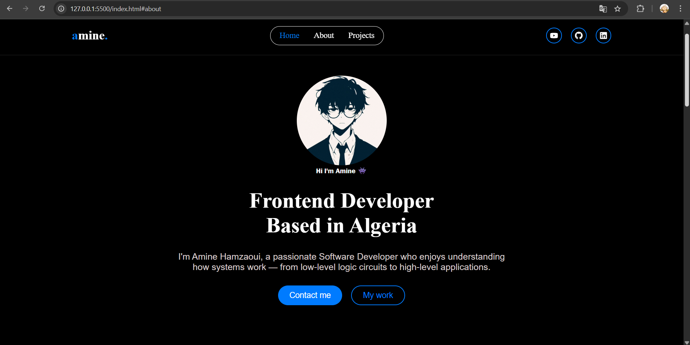

# Prem Sagar - Full-Stack Portfolio Showcase 💻

Welcome to **Prem Sagar Ajmira's Full-Stack Portfolio Web Application** — built with **React.js, Vite, and an Express.js backend**!  
A modern, modular **full-stack portfolio** featuring project showcases, interactive video previews, direct contact messaging, and backend email forwarding.

---

## 🌟 Full-Stack Architecture

### Frontend (React + Vite)
- **Port:** `3000` (proxies `/api` requests to backend on port `5000`)
- **Components:**
  - `Header.jsx`: Scroll-aware active section navigation and social links.
  - `Hero.jsx`: Profile introduction with circular photo and CTA buttons.
  - `About.jsx`: Interactive cards for tech stack, bio, globe video, and passion.
  - `Projects.jsx`: Interactive project cards with hover-to-play video previews and GitHub links.
  - `Contact.jsx`: Direct contact form submitting directly to your backend REST API.
  - `Footer.jsx`: Bottom navigation and copyright.

### Backend (Node.js & Express)
- **Port:** `5000`
- **Location:** `server/index.js`
- **Features:**
  - `POST /api/contact`: Validates inputs, saves inquiries to `server/data/messages.json`, and dispatches emails via Nodemailer.
  - `GET /api/messages`: View all received inquiries.
  - `GET /api/health`: Health status endpoint.
  - **Zero Data Loss:** Every message submitted is saved into the database, even if offline or if SMTP is unconfigured.

---

## ⚡ Tech Stack

- **Frontend:** React 18, Vite 6, HTML5, CSS3, JavaScript (ESModules)
- **Backend:** Node.js, Express 5, Nodemailer, CORS, Dotenv
- **Database:** Local JSON storage (`server/data/messages.json`)
- **Primary Skills Showcased:** Java, Spring Boot, Spring MVC, React.js, MySQL, REST APIs, Docker, Python

---

## 🚀 Getting Started

### 1. Install All Dependencies
```bash
npm install
```

### 2. Configure Email Delivery (Optional for Live Gmail Forwarding)
Open `.env` in the root folder:
```env
PORT=5000
RECIPIENT_EMAIL=premsagarajmira@gmail.com

# To send live emails to your inbox via Gmail:
# 1. Enable 2-Step Verification in your Google Account
# 2. Go to: https://myaccount.google.com/apppasswords
# 3. Generate an App Password (select 'Other' -> name it 'Portfolio')
# 4. Paste the 16-character code below:
EMAIL_USER=premsagarajmira@gmail.com
EMAIL_PASS=your_16_character_app_password
```
*(Even without `EMAIL_PASS`, messages are instantly saved to `server/data/messages.json`!)*

### 3. Run Full-Stack Development (Frontend + Backend)
```bash
npm run dev
```
Both the Express backend (`http://localhost:5000`) and the React frontend (`http://localhost:3000`) start concurrently with a single command!

---

## 📬 Contact

- **Email:** premsagarajmira@gmail.com   
- **Phone:** +91 8555040073
- **LinkedIn:** [LinkedIn](https://www.linkedin.com/in/prem-sagar-ajmira-498a46260/)  
- **GitHub:** [GitHub](https://github.com/PremSagar898)  

---

Made with ❤️ by **Prem Sagar Ajmira**
